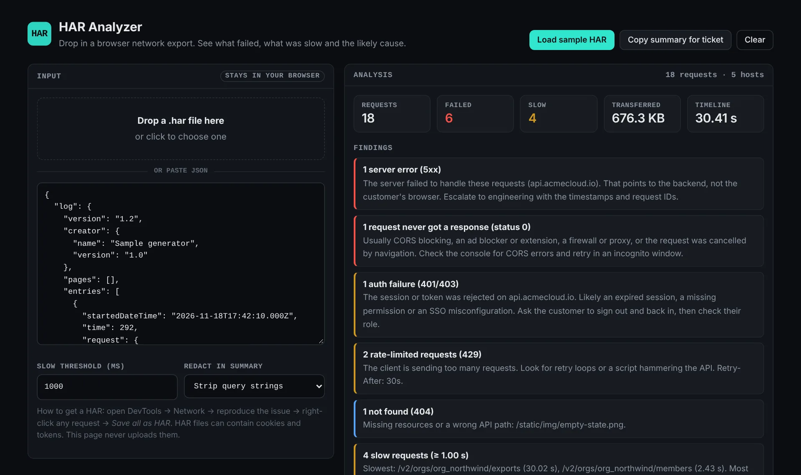
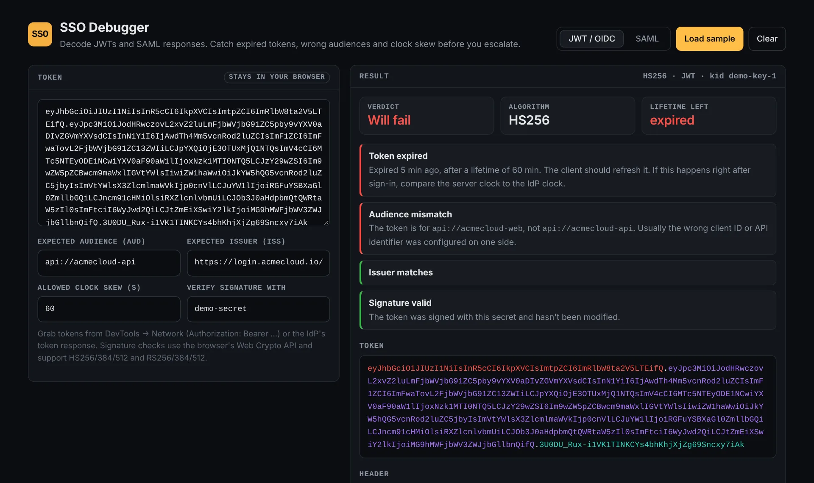
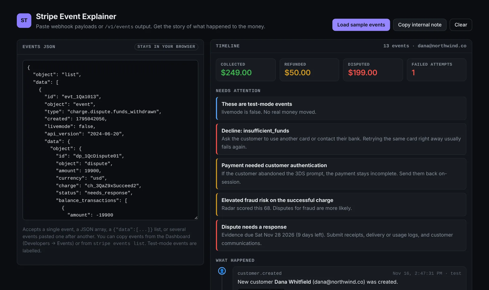
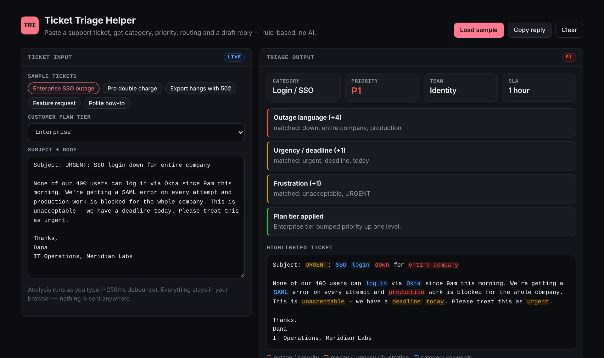

<table width="100%">
  <tr>
    <td valign="middle">
      
      <a href="https://www.linkedin.com/in/raj-prasad-3a2669140/" title="Raj Prasad"><picture><source media="(prefers-color-scheme: dark)" srcset="https://raw.githubusercontent.com/rajprasad19/rajprasad19/main/assets/rp-dark.svg"></picture></a> <b>Hey! I'm&nbsp;Raj&nbsp;👋</b>
    </td>
  </tr>
  <tr>
    <td align="center">
      
      
       
      
      
    </td>
  </tr>
  <tr>
    <td>
      <b>languages</b> 
      
      
      
      
      
    </td>
  </tr>
  <tr>
    <td>
      <b>infra</b> 
      
      
      
      
      
    </td>
  </tr>
  <tr>
    <td>
      <b>data</b> 
      
      
      
    </td>
  </tr>
  <tr>
    <td>
      <b>support stack</b> 
      
      
      
      
    </td>
  </tr>
  <tr>
    <td>
      <b>agents / ai</b> 
      
      
    </td>
  </tr>
</table>
